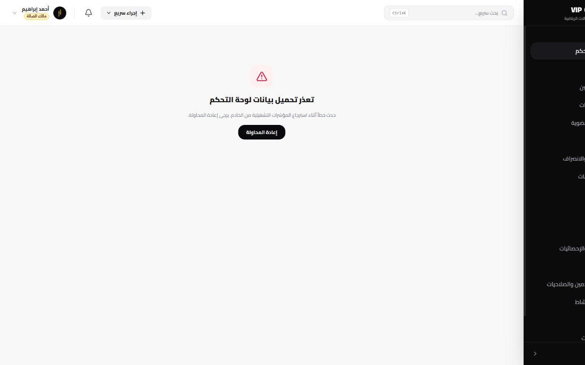

# 🏋️‍♂️ GymVIP - Gym & Fitness Management SaaS

<div align="center">



[](https://www.typescriptlang.org/)
[](https://react.dev/)
[](https://nodejs.org/)
[](https://expressjs.com/)
[](https://www.mysql.com/)
[](https://tailwindcss.com/)
[](https://www.prisma.io/)

**نظام سحابي متكامل واحترافي لإدارة الصالات الرياضية ومراكز اللياقة البدنية (Gym Management SaaS)**
<br>
*مصمم خصيصاً باللغة العربية مع دعم كامل للجنيه المصري (`ج.م`) وأرقام الهواتف المصرية ومصادقة معززة.*

</div>

---

## 🌟 مميزات النظام الرئيسية (Key Features)

- **🏛️ عزل متعدد المستأجرين (Multi-tenant Architecture):**
  - دعم كامل لعزل بيانات كل صالة رياضية (`gymId`) لضمان الخصوصية التامة والأمان.
- **👥 إدارة الأعضاء والاشتراكات (Members & Subscriptions):**
  - تسجيل الأعضاء، تجديد الاشتراكات، تجميد الاشتراكات (Freeze)، والإلغاء مع الحساب التلقائي للتواريخ.
- **💳 المدفوعات والتقارير المالية (Billing & Financial Reports):**
  - تسجيل المعاملات المالية، طرق الدفع المختلفة (نقدي، فيزا، فودافون كاش، محفظة إلكترونية)، وتقارير الإيرادات.
- **🕒 تسجيل الحضور والانصراف (Attendance Tracking):**
  - تسجيل فوري لحضور الأعضاء بالباركود/رقم العضوية والتنبيه بحالة الاشتراك (نشط، منتهي، مجمد).
- **💪 إدارة المدربين وتوزيع المتدربين (Trainers & Trainees):**
  - ربط الأعضاء بالمدربين ومتابعة جلسات التدريب ونسب الإشراف.
- **📊 لوحات تحكم تفاعلية مخصصة (Role-based Dashboards):**
  - لوحة تحكم مخصصة للمدير/المالك (`OWNER` / `MANAGER`).
  - لوحة تحكم سريعة لموظفي الاستقبال (`RECEPTIONIST`).
  - لوحة متابعة للمدربين (`TRAINER`).
- **🛡️ أمان قوي متوافق مع معايير الإنتاج (Production-Grade Security):**
  - حماية الجلسات باستخدام `HTTPOnly Cookies`، توكنات `JWT`، تشفير `bcrypt`، وتحديد معدل الطلبات `Rate Limiting`.
  - التحقق الصارم من صحة البيانات باستخدام `Zod` في الواجهة الخلفية والأمامية.

---

## 🏗️ البنية التقنية (Tech Stack)

### الواجهة الأمامية (Frontend)
- **Framework:** React 19 + TypeScript + Vite
- **Styling:** Tailwind CSS + Custom Design System Tokens
- **State Management & Server Cache:** TanStack Query v5
- **Routing:** React Router v7
- **Form Handling & Validation:** React Hook Form + Zod
- **Icons:** Lucide React

### الواجهة الخلفية (Backend)
- **Runtime:** Node.js (v20+) + Express
- **Language:** TypeScript
- **Database & ORM:** MySQL 8.0+ عبر Prisma ORM
- **Authentication & Security:** JWT (HTTPOnly Cookie), Bcrypt, Helmet, CORS, Express Rate Limit
- **Validation:** Zod Schema Validation

---

## 📁 هيكل المشروع (Project Structure)

```plaintext
GymVIP/
├── Backend/                 # كود السيرفر وواجهات برمجة التطبيقات (API)
│   ├── prisma/             # مخطط قاعدة البيانات والـ Seed
│   ├── src/
│   │   ├── controllers/    # معالجات الطلبات (Controllers)
│   │   ├── services/       # منطق العمل التجاري (Business Logic)
│   │   ├── middlewares/    # التحقق من الصلاحيات والـ Auth
│   │   ├── routes/         # مسارات الـ REST API
│   │   ├── validators/     # مخططات Zod للتحقق
│   │   └── utils/          # الدوال المساعدة والتوثيق
│   └── tests/              # اختبارات الـ API ووظائف النظام
│
├── Frontend/                # واجهة المستخدم وتجربة المستخدم
│   ├── src/
│   │   ├── components/     # المكونات المشتركة ومكتبة التصميم
│   │   ├── features/       # الوحدات الوظيفية (Members, Plans, Subscriptions, Auth...)
│   │   ├── hooks/          # الخطافات المخصصة (Custom Hooks)
│   │   └── styles/         # قواعد وتوكنات Tailwind CSS
│
├── audit-reports/          # تقارير الجودة والأداء والفحص الأمني
└── docs/                   # أدلة النشر والنسخ الاحتياطي
```

---

## 🚀 البدء السريع للتشغيل المحلي (Quick Start)

### المتطلبات الأساسية
- Node.js `20.x` أو أحدث
- خادم MySQL 8.0+

### 1. إعداد الـ Backend

```bash
cd Backend
npm install
cp .env.example .env
# قم بضبط بيانات الاتصال بقاعدة البيانات في ملف .env
npx prisma migrate dev
npx prisma db seed
npm run dev
```

### 2. إعداد الـ Frontend

```bash
cd ../Frontend
npm install
npm run dev
```

---

## 📜 الترخيص (License)

هذا المشروع مخصص للأغراض الخاصة والتجارية لصالح GymVIP. جميع الحقوق محفوظة © 2026.
