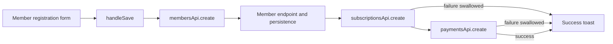
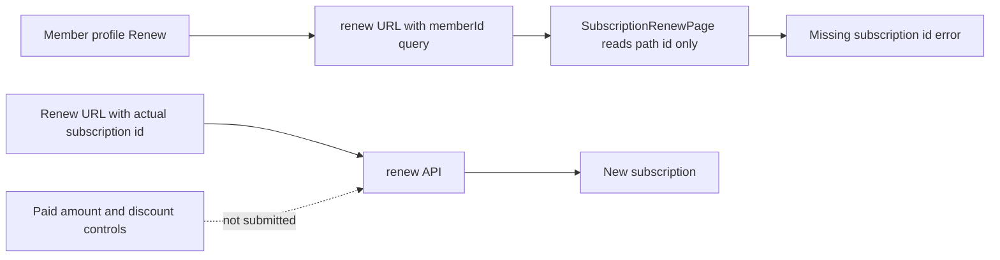

# Frontend audit

Audit date: 2026-11-11. Scope: existing source, read-only inspection; no application edits or installs. Paths below are relative to `D:/GymVIP`. Findings are **VERIFIED IN CODE** unless explicitly marked otherwise. No authenticated browser workflow was executed by this reviewer. API use in source is not proof of persisted runtime integration. Coverage includes route inventory, page handlers/data acquisition and targeted shared-component inspection; it does not establish that every DOM control, breakpoint, or race condition was exercised.

## Executive assessment

The frontend contains substantial real API integration, but is not production-ready. The highest-risk problems are false financial success, simulated registration, offline mock authentication, disconnected renewal inputs, mock trainer assignments, and misleading payment totals. Preserve real member, plan, attendance, notification, settings and audit-log implementations while fixing these boundaries.

Frontend source quality score: **48/100**, a rubric-based engineering assessment, not measured feature completion. Function/data correctness 12/30; failure handling 9/20; maintainable structure 13/20; accessibility implementation 6/15; permission/session UI behavior 8/15. Credit: typed service modules, real handlers, reusable primitives, Query integration on several screens. Deductions follow F01–F19. Runtime usability and visual quality remain NOT ASSESSED.

## Findings and reproduction recipes

Recipes are safe isolated-test instructions, not claims that actions were run against business data.

| ID / priority | Finding, impact and exact evidence | Isolated reproduction / acceptance direction |
|---|---|---|
| F01 P0 | `Frontend/src/features/auth/context/AuthContext.tsx:103` creates a mock user on network error, defaulting to OWNER. Local storage is trusted at :22; session-loading begins false at :32; verification only clears on 401 at :61. This is a false frontend login, **not evidence of backend authorization bypass**. | Block login requests in a disposable browser profile, submit arbitrary credentials: source takes mock-success path. Remove production fallback; wait for session verification and fail closed on unavailable authentication. |
| F02 P0 | `Frontend/src/features/members/pages/MemberCreatePage.tsx:203` creates member, then subscription (:217), then payment (:227). Nested catches at :234 and :238 only log; :243 claims member, activation and collection success. Partial failures are concealed and data is left partially created. | Stub subscription/payment failure after successful member creation. UI must report exactly which operations persisted, offer safe recovery, and never claim collection without a payment. |
| F03 P0 | `Frontend/src/features/payments/pages/PaymentsListPage.tsx:986` refund confirmation only shows a success toast and closes. :1035 payment edit does the same; neither persists. | Open refund/edit on a fixture, confirm, inspect network and reload. Replace with audited server operations or disable accurately until implemented. |
| F04 P1 | `Frontend/src/features/auth/pages/RegisterPage.tsx:47` handler uses timers, not `authApi.register`; it announces success and navigates to protected dashboard. Rules at :61 simulate valid states; terms default checked at :45. | Submit registration against mocked API capture: no registration request. Wire registration payload including gym/owner data, true validation, server errors, session initialization and onboarding. |
| F05 P1 | `Frontend/src/features/subscriptions/pages/SubscriptionRenewPage.tsx:81` reads only URL `id`; :190 rejects missing ID. `MemberDetailPage.tsx:427` passes `?memberId=…` and `MembersListPage.tsx:653` supplies no identifier. Both route to renewal without the required id. | Click renew from member detail/list. Resolve current subscription by member or navigate with concrete subscription id. |
| F06 P0 | `SubscriptionRenewPage.tsx:159` stores discount/payment choices, but :197 sends only planId, notes and startDate. No payment API call is present. Success can imply a paid renewal without collection; discount is never applied. | Renew a fixture selecting discount and paid amount. Compare request with displayed totals; make financial handling explicit and persistent. |
| F07 P1 | `PaymentsListPage.tsx:76` fetches at most 100 with only search/method. Time, employee and operation filters declared at :63–68 do not enter request or filtering at :135. :177 returns all filtered total when today's total is zero. All rows map to COMPLETED at :114. | With older payments and no payment today, inspect today's tile; toggle period/employee filters. Use server aggregates and complete pagination; zero must remain zero. |
| F08 P1 | `Frontend/src/features/trainers/pages/TrainerDetailPage.tsx:45` defines sample trainees; :117 initializes displayed list with them and real trainer fetch :138 does not replace them. :145 swallows failures. Transfer at :965 only removes local item. | Open two real trainers and compare trainees; transfer and reload. Load real assignments, add assignment mutation, explicit error/empty states. |
| F09 P1 | `Frontend/src/features/settings/pages/ProfilePage.tsx:78` and :117 use admin user-management update/reset-password APIs, but `Backend/src/routes/user.routes.ts:27` requires OWNER/MANAGER for every route. Profile is available to all authenticated users. | As receptionist/trainer, save own profile/password; source guarantees RBAC mismatch. Add restricted self-service endpoints; do not relax admin routes globally. |
| F10 P1 | `ProfilePage.tsx:82` updates localStorage but not AuthContext user. Avatar at :683 only enters component state; :705 claims saved without persistence. | Save name, inspect header until reload; upload photo and reload. Update canonical auth state and real avatar storage. |
| F11 P1 | `Frontend/src/app/config/queryClient.ts:3` singleton cache has five-minute freshness; query keys such as dashboard are not session scoped. `AuthContext.tsx:121` logout does not clear cache. **SUSPECTED runtime exposure:** cached account A data can remain on account B login in same SPA. | Isolated two-tenant login/logout test; assert no prior-tenant cache or flash. Clear/cancel caches on identity transition and scope keys by gym/user. |
| F12 P1 | `Frontend/src/services/api.ts:40` only logs 401; authenticated state is not centrally invalidated. Protected routes can retain expired UI session after API failures. | Expire a fixture session and perform a request. Clear auth/cache, preserve safe return location and show session-expired feedback. |
| F13 P1 | `Frontend/src/features/members/pages/MembersListPage.tsx:193` load failure only console-logs. `AttendancePage.tsx:140`, `ReceptionDashboardPage.tsx:87`, `TrainerDashboardPage.tsx:51`, `TraineeAttendancePage.tsx:67`, `MemberDetailPage.tsx:168` convert request failures into null/empty collections. Empty business state is indistinguishable from unavailable data. | Return 500/403 per subrequest. Render panel-specific unavailable/retry state instead of fabricated zero/empty. |
| F14 P1 | `Frontend/src/features/reports/pages/ReportsPage.tsx:62` queries consume loading/data but not errors; content at :291 requires data and can disappear on failure. | Fail summary report request. Show report error/retry and preserve date filters. |
| F15 P2 | `Frontend/src/features/subscriptions/pages/PlansListPage.tsx:431` copy action is toast-only; :817 reorder only clones same local array then announces saved. | Copy/reorder fixture, inspect requests and reload. Connect persistent operations or remove misleading affordances. |
| F16 P2 | `Frontend/src/components/layout/GlobalSearchModal.tsx:25` searches a static navigation list despite placeholder promising members/subscriptions/transactions at :70. Help at :118 advertises arrows/Enter but no selection-key handler exists. `QuickActionsMenu.tsx:23` and search list do not filter by role. | Search known member; test arrows; use trainer role. Either label as page navigation or implement permission-aware entity search and keyboard navigation. |
| F17 P2 | `Frontend/src/components/ui/Modal.tsx:65` has dialog semantics but no focus trap/restore or labelled-by; Drawer at :75 lacks dialog role/focus handling. Inline feature modals duplicate these deficiencies. | Keyboard-only open, Tab past last control, Escape and return-focus test. Consolidate on accessible modal/dialog implementation. |
| F18 P2 | `Frontend/src/components/ui/Input.tsx:40` generates IDs from labels (duplicates possible), displays errors without aria-describedby/aria-invalid. Many feature labels are raw labels without linked input IDs. `FileUpload.tsx:30` checks size but drop handler does not enforce accept type; it is a file picker, not upload persistence. | Render two identically labelled inputs; screen-reader error test; drop wrong extension on component. Use unique IDs, described errors and explicit validation. Server validation remains required. |
| F19 P2 | All pages including design-system are eager imports in `Frontend/src/app/router/routes.tsx:7`. Giant page modules and local copies of modal/toast/form patterns reduce consistency. `SubscriptionCreatePage.tsx:75` uses `any[]`, and many API catch blocks use `any`. | Profile build and route loading before optimization; introduce route chunks and typed error handling incrementally. No runtime rerender or memory-leak measurement was performed. |

## Page-by-page inventory

Every entry is source-assessed; **fully working at runtime: NOT VERIFIED**. Route roles below are frontend gates, not a substitute for backend RBAC. Common `/app` prefix omitted. L/E/S = loading/error-or-empty/success behavior visible in source, with gaps noted. “API” means real client calls exist, not runtime CONNECTED certification. All page breakpoint outcomes remain NOT VERIFIED.

| Route → page | Business purpose / data | Controls, forms and states | Permission / improvement |
|---|---|---|---|
| `/` | Redirect to login | Navigate | No role-specific home |
| `/login` → LoginPage | Staff session; real auth plus unsafe mock fallback | Form, busy, success/error; demo credential prefills and role picker; rememberMe is UI state | Guest; F01/F12; remove demo literals; backend decides role |
| `/register` → RegisterPage | Gym signup | MOCK ONLY timer form; simulated rules and preview state | Guest; F04 |
| `/setup`, `/onboarding`, `setup` → GymSetupWizardPage | Gym initial setup; gym profile/completeSetup API | Wizard, validation, success/error; defaults and schedule state | Public aliases lack wrapper; backend must reject unauthenticated use; :108 sends setup |
| `dashboard` → DashboardPage | Operational KPIs; dashboard API :32 | Query loading, error/retry, empty panels, navigation | Any authenticated route; verify role-specific data |
| `reception`, `reception/dashboard` → ReceptionDashboardPage | Quick member/payment/check-in operations; dashboard/member/payment/attendance clients | Real mutation handlers and toasts; per-request failures swallowed :87 | Any authenticated route; F13 |
| `members` → MembersListPage | Paginated members/status/search; membersApi :92 | Search/filter/page/select/status/drawer; load errors hidden; renew context lost | Authenticated; F05/F13; server must gate modifications |
| `members/search`, `search` → MemberSearchPage | Search and immediate check-in; members and attendance APIs :59/:86 | Debounced search, cards/table, loading/empty/toast; no demonstrated cancellation of in-flight searches | Authenticated; stale response race SUSPECTED |
| `members/new` → MemberCreatePage | Register member, optional sale/photo | Validates required name/phone; FileReader image validation; real three-step API; false success | Authenticated; F02; atomic/recoverable workflow |
| `members/:id` → MemberDetailPage | Profile, histories, freeze/check-in/edit/status | Real APIs :145/:167/:223/:250/:282; secondary failures hidden; mock activity timeline :912/:923; renewal broken | Authenticated; hide unauthorized actions; F05/F13 |
| `plans` → PlansListPage | Product catalog | API list/status/delete; copy/reorder disconnected; loading/empty/toasts | OWNER/MANAGER; F15 |
| `plans/new` → PlanCreatePage | New membership product; plansApi.create :78 | Manual required name/price validation; saving/error/success; visual preview CTA is intentionally nonfunctional | OWNER/MANAGER; distinguish preview from action |
| `plans/:id/edit` → PlanEditPage | Update product; get/update/status :75/:104/:126 | Loading/toasts; fetch failure still leaves form state to inspect | OWNER/MANAGER; prohibit saving unavailable record |
| `subscriptions` → SubscriptionsListPage | Membership lifecycle list; subscriptionsApi :35 | Filters/loading/empty/toast/navigation | Authenticated; exercise pagination and status boundaries |
| `subscriptions/new` → SubscriptionCreatePage | Sell membership; member/plans/subscriptions/payment APIs | Search, preview, confirm, separate payment request; payment failure warning :250; displayed financial choices require payload reconciliation | Authenticated; retain partial-success identity for recovery |
| `subscriptions/:id` → SubscriptionDetailPage | Subscription/payment/freeze/cancel detail | Main loading/error; secondary histories swallow errors :86/:96; freeze/payment APIs :1023/:1213; cancellation component exists | Authenticated; validate role visibility and financial history |
| `subscriptions/:id/renew`, `subscriptions/renew` → SubscriptionRenewPage | Renewal | API renew only; missing-id route broken; fallback plans; money fields disconnected | Authenticated; F05/F06 |
| `payments` → PaymentsListPage | Financial ledger | Real list but capped, incorrect date/today/filter logic; fake refund/edit | OWNER/MANAGER/RECEPTIONIST; F03/F07 |
| `payments/new` → PaymentCreatePage | Collect outstanding balance; subscriptions/payments APIs | Positive and outstanding amount validation :142–152, submitting/toasts; selection initially first 50 subscriptions :55 | OWNER/MANAGER/RECEPTIONIST; full server-backed search needed |
| `payments/:id` → PaymentDetailPage | Receipt and payment history | Real get/history :66/:71; retry; print invokes window.print :57; more options toast-only :210; secondary summary failure ignored :74 | OWNER/MANAGER/RECEPTIONIST; show unknown balance rather than zero |
| `attendance` → AttendancePage | Reception entry/exit, occupancy | Summary/live/history APIs; search first matching member :172; confirmation and mutation feedback; errors masked :140 | Authenticated; explicit identification before check-in; :142 history capped 100 |
| `attendance/trainees`, `trainees/attendance`, `trainer/attendance` → TraineeAttendancePage | Trainer attendance | Real attendance list/live/check-in/out; failures become empty; cap 50 :67 | Authenticated; trainer authorization must be verified server-side |
| `trainers` → TrainersListPage | Staff trainer directory | Real list/status/delete, confirmations/toasts; list cap 100 :95 | Authenticated route, mutations locally gated; verify dataset-wide search |
| `trainers/new` → TrainerCreatePage | Create trainer account | Real API :40, required validation and error/saving state | OWNER/MANAGER |
| `trainers/:id` → TrainerDetailPage | Trainer profile/assignment/history | Real profile/update/status; mock trainees/history; local transfer, toast photo | Authenticated; F08 |
| `trainer/dashboard`, `trainer` → TrainerDashboardPage | Trainer operational view | Dashboard/live/history/member APIs; catch-to-empty; members cap 50 :54 | Authenticated; not trainer-exclusive route; F13 |
| `trainer/trainees`, `trainees` → TrainerTraineesPage | Trainer roster | Calls generic members list :71; pagination/search/check-in; does not send trainer assignment identifier | Authenticated; absence of assignment filtering in UI; backend scope determines actual exposure |
| `reports` → ReportsPage | Date-filtered summaries | Five query families, loading/empty; no explicit query error UI | OWNER/MANAGER; F14 |
| `notifications` → NotificationsPage | Inbox/read state | Query list/count, read/all-read mutations with invalidation :75/:87; explicit loading/error/empty; pagination | Authenticated; positive integration pattern |
| `users` → UsersListPage | Staff CRUD/role/password/status | Real service mutations :170/:203/:225/:249/:264/:283; modals, validation/toasts; list errors toast | OWNER/MANAGER; verify server hierarchy rules |
| `activity-log` → ActivityLogPage | Audit history/filter/detail | Query :98, loading/error/retry/empty :254; drawer detail | OWNER/MANAGER; positive state pattern |
| `settings` → SettingsPage | Gym configuration | React Hook Form + Zod, query/mutation, setQueryData :193, dirty/error/success, logo field | OWNER/MANAGER; strongest form pattern to reuse |
| `profile` → ProfilePage | Self profile/password/avatar | Real admin API calls but inaccessible for two roles; local avatar and stale auth state | All authenticated; F09/F10 |
| `/design-system` → DesignSystemPage | Component showcase | Demonstration content, not operational data | Public eager route; isolate from production bundle |
| `/403`, `/500`, `*` → error pages | Denied/server/not-found feedback | Standalone navigation controls | Public; runtime keyboard/responsiveness NOT VERIFIED |

## State, components and maintainability inventory

Provider chain: `AppProviders.tsx` → ErrorBoundary → QueryProvider → AuthProvider → ToastProvider. Router uses ProtectedRoute and GuestRoute. `Frontend/src/hooks/useAuth.ts` and `features/auth/hooks/useAuth.ts` re-export the same context hook; they are compatibility aliases, not independent auth stores. Most operational pages use local state/effects; dashboard/settings/notifications/reports/activity log use React Query. No Redux/Zustand dependency is declared.

Shared UI inventory (`Frontend/src/components/ui`): Alert, Avatar, Badge, Button, Card, Checkbox, ConfirmationDialog, ConfirmationModal, ContextMenu, DateInput, DatePicker, Drawer, Dropdown, EmptyState, ErrorState, ExportDropdown, FileUpload, GlobalSearch, Icon, Input, Loading, LoadingState, Modal, NumberInput, OTPInput, Pagination, PasswordInput, Radio, SearchInput, Select, Skeleton, StatCard, Switch, Table, Tabs, Textarea, Toggle, Tooltip and barrel index. Their existence is verified; comprehensive interactive conformance is NOT VERIFIED. Modal/Drawer/Input/Table/FileUpload were inspected directly. Table provides horizontal overflow, skeleton and empty primitives. FileUpload selects local files and invokes a callback; it is not a storage integration.

Layout inventory: AppLayout, Sidebar, Header, PageHeader, GlobalSearchModal, QuickActionsMenu, PlaceholderPage. Feedback: ErrorBoundary and Toast context. Feature composites: CancelSubscriptionModal and AuditLogDetailDrawer. Duplication candidates requiring import-aware cleanup after approval: ConfirmationDialog versus ConfirmationModal; DatePicker versus DateInput; Loading versus LoadingState; generic GlobalSearch versus layout GlobalSearchModal; local inline dialog/toast markup versus shared equivalents. These are **not all proven dead components**. No component should be deleted solely from this inventory. Placeholder/demo assets and showcase are not evidence of mocked business flows by themselves.

Service inventory: central Axios `services/api.ts`, export client, and feature clients auth, members, plans, subscriptions, payments, attendance, trainers, dashboard, reports, notifications, gym, users, activity log. Client functions generally unwrap `data.data` and some assert required entities, while history helpers silently default missing response payloads to empty arrays. `authApi.register` exists at `features/auth/services/authApi.ts:45` but RegisterPage never calls it. `trainersApi.getMe` exists; trainer screens instead consume generic members/dashboard data and need assignment semantics confirmed.

## Disconnected and hardcoded behavior register

* Production-path mock login: AuthContext :5/:103; demo account/password literals in LoginPage :34/:52 (values intentionally omitted).
* Fake signup and simulated validation: RegisterPage :47/:61; promotional statistics and compliance/endorsement claims are hardcoded copy, not independently verified business facts.
* Trainer sample assignments: TrainerDetailPage :45/:117; static history :641; photo action :220; transfer :965.
* Renewal default product list: SubscriptionRenewPage :38/:147; hardcoded current end date :95; `SUB-00841` exception :101. These are not safe fallbacks for unavailable live plans.
* Renewal payment/discount controls: SubscriptionRenewPage :159/:197; no persistence.
* Payment refund/edit: PaymentsListPage :986/:1035; hardcoded completion status :114.
* Plan copy/reorder: PlansListPage :431/:817. Live card preview CTA in PlanCreatePage :570 is intentionally illustrative, not a missing API by itself.
* Member activity entries: MemberDetailPage :912/:923. Printed membership-card action :490 only announces printing; verify desired card-generation implementation before claiming QR capability.
* Profile photo: ProfilePage :683/:705; local-only. Member photo handling is different and DOES send avatarUrl to members API.
* Payment detail extra options: PaymentDetailPage :210 toast advertises WhatsApp/PDF without implementation there; actual window.print is separately wired.
* Global search: static route list, not member lookup. Financial/time/staff filters listed in F07 are visual-only controls.

## Trace examples

No network cancellation mechanism was identified in the inspected manual search effects. Out-of-order response rendering is a **SUSPECTED** risk, not a measured leak. Many timers clear transient toasts without cleanup; actual memory leakage was not measured. Pagination exists in several primary lists but fixed-limit secondary pages must be audited with datasets above their limits. No visual breakpoint, frontend test or user-task completion measurement is asserted in this report.
